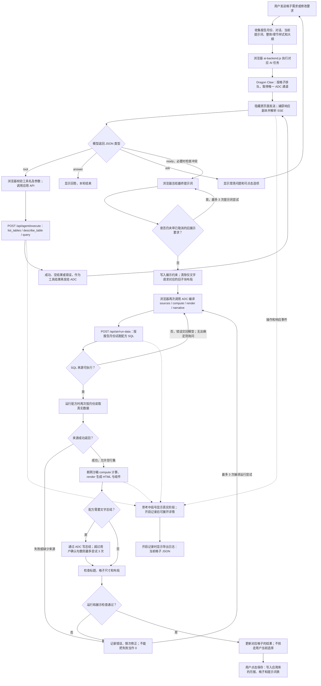
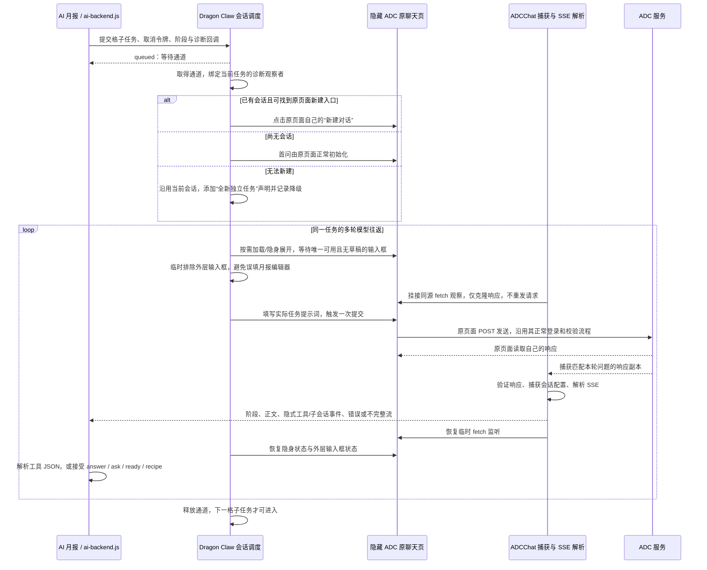
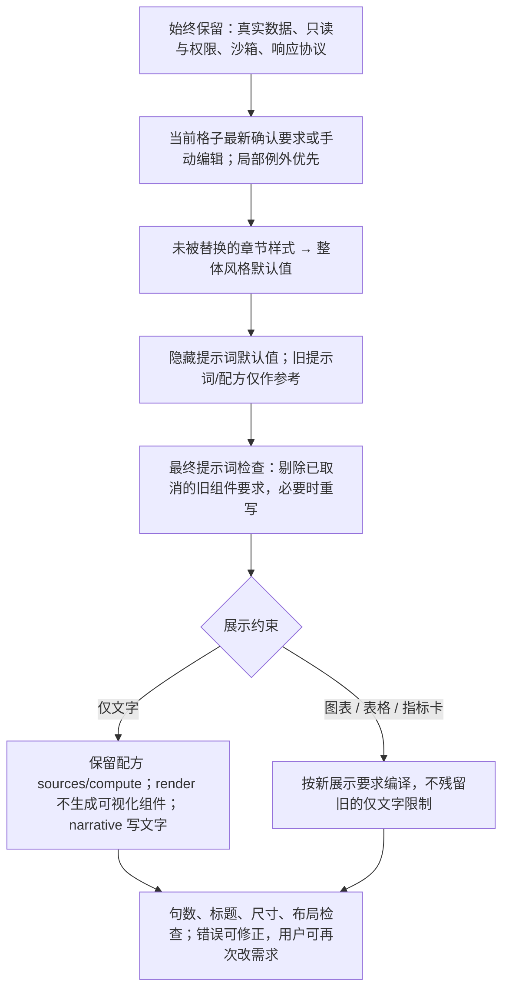

## 独立模型 API

月报工具栏「AI 模型」或「开发者模式 → 工具 → AI 模型配置」可新增、测试、加密保存和切换模型。支持 HTTP/HTTPS 的 OpenAI 兼容、Responses、Claude、Gemini、Ollama 及自定义 POST JSON 文本接口，继续支持 ADC 页面。配置存放在分配的应用库，API Key 和高级配置在服务端使用认证加密，读取时不回显。更新已有应用后需要执行 `db/upgrade.sql`（模拟基座执行 SQLite 对应脚本）；迁移时同时备份独立的加密密钥。详见 [模型配置与部署说明](docs/ai-models.md)。

# Dragon-Platform-online · AiOps-Report

[](https://www.python.org/)
[](https://fastapi.tiangolo.com/)
[](https://www.uvicorn.org/)
[](https://github.com/fanxiaolongx-max/Dragon-Platform.git)

**AiOps-Report** 是运营数字人写报告服务（版本 `1.8.7`），专为质量运营与服务合控场景设计。服务串联了指标目录、多源业务数据直查、要素分析与月度/专项报告自动化生成。

本仓库是作为 [Dragon Platform](https://github.com/fanxiaolongx-max/Dragon-Platform.git) 托管 Python 应用的**独立开发与协同仓库**，既支持独立作为 FastAPI 微服务本地运行，也可无缝部署到 Dragon Platform 中台，由平台自动代理并提供在线 IDE、版本回退与双轨数据库挂载。

---

## 1.8.6 更新说明

- 修复文字总结未指定输出预算的问题：总结请求使用 4000 tokens 的任务上限（仍受模型配置上限约束，显式附加参数保留覆盖语义）。
- 兼容 OpenAI 网关忽略 `stream:false` 而返回的 SSE，合并正文和用量；流中断、截断和错误事件继续报错，不保存半份总结。
- 区分空响应、非 JSON 网关响应和结构不匹配，失败日志记录请求编号、HTTP 状态、Content-Type、响应字节数和耗时；不记录请求头、原始响应或密钥。
- 模型调用失败后停止自动改写配方；已经计算的数据和图表保留，章节样式操作失败仍回到之前的内容。

需求广场 154 的三次错误都发生在文字总结的 HTTP 响应解析，数据查询及编译成功。原日志缺少响应类型，无法追溯确定当时是空响应、网关错误页还是流式响应。此版本覆盖这些分支并补充诊断；生产模型仍需在更新后复测。本次不修改数据库结构，无需执行升级 SQL。

## 1.8.0 更新说明

针对内网慢模型（ADC 每轮往返 10–80 秒）减少一次提问的往返次数。生产日志里一次格子提问约 15 轮往返、17 分钟，查库本身每次只要 0.1 秒左右，时间几乎都在模型往返上。

- **一次回复可调用多个工具**：工具协议支持 `{"tools":[{"tool":…,"args":…},…]}`（最多 4 个，几行各写一个 `{"tool":…}` 也认），页面并行执行后把结果一起发回模型。
- **第一轮之前页面先查资料**：按问题文字调用新工具 `suggest_tables`（按表备注、模块、表名打分推荐候选表，并附前两张的字段），放进任务内容，模型不用从 list_tables、describe_table 开始一步步摸索。
- **问答阶段查到的东西带进后续步骤**：同一页面里已查到的表字段、按值查找结果、试跑通过的 SQL，按提示词或对话里出现的表名带进后续提问和「生成格子」，不再从头找表。
- **新工具 `find_value`**：在一张表的地区、代表处、国家、运营商、产品等文字列里一次查出包含某个值的列和取值（如「埃及」在哪一列、各多少行），替代逐列 GROUP BY 摸索。
- **工具结果缓存**：同一页面里同一张表的字段、同一条 SQL 在 5–10 分钟内直接复用；出错不缓存。
- **超时后清掉残留草稿**：经原页面发送超时时，脚本自己填进 ADC 输入框的问题会被清掉，下一次提问不再报「输入框已有未发送草稿」；用户自己写的草稿仍然保留并提示。
- **交互日志补全**：
  - 新增「AI 操作汇总」：每次 AI 月报操作记一条，标题直接写「ADC 往返 N 轮，工具 M 次（缓存命中 K 次），用时 X 秒」，展开可看每一轮的模型耗时和这一轮调用的工具、工具耗时、页面预取情况。
  - 新增「模型 API 对话」：模型 API 方式的每次提问记下提问、回答、模型、对话轮数和失败原因（以前只记成功、没有内容）。
  - 上报不再静默丢失：平时用普通请求上报（不受 keepalive 64KB 限制），失败的批次最多重试 3 次，只在关闭页面时用 keepalive 并分批；服务端整批写入失败时逐条重写，一条坏记录不再连累同批日志；记录时间以浏览器发生时间为准。

## 1.6.0 更新说明

- **交互日志**：开发者页「工具 → 交互日志」可查看最近 N 条或 N 天内，开发者页与 AI 月报和外部的全部交互：每次基座数据库 API 请求（库、SQL、涉及的表、返回行数、HTTP 状态、错误、请求编号、来自哪个页面和接口）、每次 ADC 内嵌对话（提问、回答、耗时、是否经原页面发送、是否新建对话、失败原因）、业务表清单刷新。可按类型、成功 / 失败、关键字筛选，点开一条看完整记录，可导出 JSON。
- **表失败标签**：业务表查询失败（源表直查、AI 月报取数等）会给这张表记失败次数；源表直查下拉在表名旁显示红色「失败 N」，和空表一样置灰排在最后；之后只要查成功一次就自动消除。网络、限流、鉴权、网关和业务数据源配置这类整体故障不记到单张表上。
- **业务表清单自动刷新**：每次打开 AI 月报或开发者页，自动查一次 `GET /data/tables?source_db=netcare` 的最新表名，和上次对比；交互日志里醒目显示「新增 X 张，减少 Y 张」，展开可看具体是哪些表并带模块 / 类别 / 空表 / 失败 / 新增标签。源表直查下拉以最新清单为准优先展示，最新清单里新出现的表可直接查，最新清单里没有的表标「清单外」；AI 月报的 list_tables 工具也按最新清单返回，并把空表和失败的表排在后面。
- 存储沿用既有 `t_report_config`（`report_id = 0`，section 为 `ops_log` / `ops_tbl_health` / `ops_tbl_snap`），不新增表、不需要 DBA 执行升级脚本；日志批量写入，保留 30 天后自动清理。

## 1.5.11 更新说明

- 修复 Dragon Claw 浮窗「原 ADC 聊天页」亮暗切换无效：按钮改为直接开关整页反色（「反色」/「原色」），点击必定生效并按浏览器记住；页面跨域读不到内容时也能反色。没点过时仍自动判断，暗色检测增加按文字颜色反推。

## 1.5.10 更新说明

- 格子旁显示真实执行阶段；调用记录可展开模型、工具和应用接口的实际请求与返回，支持详细 JSON 日志导出。
- 隐藏 ADC 页面准备、会话创建、输入与提交、响应捕获、SSE、隐式工具和子会话事件纳入诊断；凭据脱敏，关闭记录时隐藏导出按钮。
- 修复仅文字请求残留指标卡、总结超出已确认句数等问题；允许恢复图表或卡片，保留数据与计算，统一格子例外、章节样式和整体默认规则的优先级。
- README 增加完整工作流程与隐藏 ADC 时序图；新增单元与本地浏览器链路测试并接入 CI。

本版不迁移或批量重写历史月报。更新应用后刷新页面，原有问题格子需重新生成最终提示词并运行。真实内网 ADC 的登录与页面结构仍需在目标环境验收。

## 🌟 核心特性

- 📊 **运营报告自动生成**：支持月报、周报、质量运营大屏所需的数据要素提取、维度透视与自动化排版渲染。
- 🔎 **441 张 NetCare 业务表直查与映射**：内置《运营指标-索引目录》与业务库落地表完整映射，支持上游源表自动转换为落地表，提供字段白名单校验、多条件组合查询与快速预览。
- ⚡ **高性能异步架构**：基于 FastAPI + Starlette + Uvicorn 异步驱动，支持单进程高并发与标准 OpenAPI 文档（`/docs` 与 `/redoc`）。
- 📝 **AI 月报（主页）**：移植自 Dragon Platform 的 AI 月报编辑器。每个格子用对话说明要展示什么，AI 直接查业务库表结构、写出按月运行的 SQL 配方，图表和数字每月从业务库实时取数，不再需要导入数据；月报、格子和提示词都存进应用库，可在开发者模式或助理对话里增删改（见下文「AI 月报」）。
- 🐉 **Dragon Claw 助理 + 数据能力**：页面右侧常驻 AI 助理，可通过对话查询业务库 / 应用库并做统计；新增、修改、删除应用表前展示变更预览，用户确认后才执行，并记录审计日志（见下文「Dragon Claw 数据能力」）。
- 💻 **Dragon Platform 在线 IDE 深度适配**：
  - 代码在平台内实时热编辑，自带现代深色代码高亮、多 Tab 编辑与优雅拟态弹窗。
  - 绑定独立 Git 仓库（`Dragon-Platform-online.git`），支持在线 Commit、Push、Pull 与历史提交一键版本回滚。
- 🗄️ **双轨数据库隔离体系**：
  - **业务库（只读）**：由平台环境变量 `BUSINESS_DATASOURCE_NAME` 注入，具备安全只读沙箱，防止越权破坏。
  - **应用库（专属读写）**：由 `APP_DATASOURCE_ID=app` 映射到本地独立 SQLite（`db/app.db`），持久化用户配置、自定义查询快照与报告草稿。

---

## 📁 目录结构

```text
Dragon-Platform-online/
├── app/                        # 核心应用源码
│   ├── main.py                 # FastAPI 入口工厂 (create_app)
│   ├── config.py               # Pydantic 环境变量与配置定义
│   ├── db.py                   # 数据库连接池与会话管理
│   ├── core/                   # 核心基础能力 (日志、异常处理、拦截器)
│   ├── dao/                    # 数据访问层 (Data Access Objects)
│   ├── routers/                # REST API 路由层
│   │   ├── health.py           # 健康检查接口 (/health)
│   │   ├── report.py           # 报告生成与管理 (/api/report)
│   │   ├── data_element.py     # 数据要素提取与分析
│   │   ├── data_source.py      # 多数据源配置与切换
│   │   ├── data_query.py       # 业务库 SQL 动态查询与透视
│   │   ├── table_map.py        # 441 张源表与业务表映射字典
│   │   ├── agent.py            # Dragon Claw 能力清单与受控执行器 (/api/agent)
│   │   └── air.py              # AI 月报：文档读写、格子 / 提示词增删改、配方取数 (/api/air)
│   ├── schemas/                # Pydantic 输入输出模型
│   ├── services/               # 核心业务逻辑服务（agent_service.py：工具协议 / SQL 守卫 / 写入确认 / 审计；air_service.py：AI 月报存储与按月取数）
│   └── utils/                  # 辅助工具函数
├── static/                     # 前端静态资源
│   ├── index.html              # 主页：AI 月报（/）
│   ├── dev.html                # 开发者模式：数据链路 / 源表直查 / 接口调试（/dev，旧地址 /api-test）
│   ├── air/                    # AI 月报前端（移植自平台）+ ai-backend.js（浏览器端 AI 后端，经 ADCChat 调模型）
│   ├── shared/                 # 两个页面共用：Dragon Claw 助理浮窗、会话调度、线性图标
│   ├── vendor/echarts.min.js   # 图表库（内网离线可用）
│   └── data/                   # 表映射与全表目录（table_map 路由读取）
├── db/                         # 应用本地数据与 SQLite 存储
├── logs/                       # 运行日志输出目录
├── requirements.txt            # Python 依赖清单
├── run.py                      # 本地独立启动脚本 (uvicorn)
├── _platform_host.py           # Dragon Platform 宿主反向代理前缀适配层
├── AiOps-Report.version        # 版本标识文件（以文件内容为准）
└── README.md                   # 项目说明文档
```

---

## 🚀 快速开始

### 方式一：独立本地运行

#### 1. 克隆仓库与配置环境

```bash
git clone https://github.com/fanxiaolongx-max/Dragon-Platform-online.git
cd Dragon-Platform-online

# 推荐使用 Python 3.10+ 创建虚拟环境
python3 -m venv venv
source venv/bin/activate  # Windows: venv\Scripts\activate

# 安装依赖
pip install -r requirements.txt
```

#### 2. 配置环境变量

可创建 `.env` 文件覆盖默认配置（可选）：

```env
APP_NAME=AiOps-Report
PORT=5600
WORKERS=1
RELOAD=false
LOG_LEVEL=INFO
```

#### 3. 启动服务

```bash
python run.py
```

服务启动后，默认监听在 `http://127.0.0.1:5600`：
- **AI 月报（主页）**：[http://127.0.0.1:5600/](http://127.0.0.1:5600/)
- **开发者模式（API 调试台）**：[http://127.0.0.1:5600/dev](http://127.0.0.1:5600/dev)（旧地址 `/api-test` 同一页面）
- **Swagger 接口文档**：[http://127.0.0.1:5600/docs](http://127.0.0.1:5600/docs)
- **健康探测**：[http://127.0.0.1:5600/health](http://127.0.0.1:5600/health)

---

### 月报页中的浮窗与开发者模式

Dragon Claw 浮窗在首次打开、恢复历史位置、拖拽、调整宽高、浏览器窗口及可见视口缩放时统一限制四边，始终保留可见区域内的边距；小视口自动降低最小宽高。标题栏、消息复制、代码复制与底部按钮使用助理的暗色样式。

月报顶部「开发者模式」在当前页打开接近全屏的大弹窗，不跳转 `/dev`。它从应用静态资源加载已有工作台，沿用月报的 API 路径前缀；保留月报编辑状态与开发者表单，支持关闭按钮、Esc 和「AI 月报」返回入口。从开发者工作台打开 Dragon Claw 时会关闭弹窗并唤起月报中的同一个助理。独立的 `/dev` 与 `/api-test` 路由仍可使用。

首次对话通过原 ADC 页面建立会话时，「展开」会显示「首次对话连接中…」与等待原因，点击时仍可查看提示；该次请求结束后恢复展开。已经建立会话后的普通对话不限制展开。数据调用失败时，点击卡片上的「失败 · 查看详情」可展开并复制后端错误文本、HTTP 状态、业务错误码、请求 ID（后端有返回时）、时间及工具/数据源/表名等上下文；HTTP 200 与业务成功分别展示。详情不附带完整响应、请求头、写入值或确认令牌，常见凭据会脱敏。

浏览器回归测试使用本地模拟 API / ADC，覆盖越界位置恢复、四向拖动、两种尺寸调整、暗色按钮、视口缩放、根路径 / 基座前缀、沙箱嵌入与弹窗状态保留；GitHub Actions 测试通过后才发布 Release。真实基座仍需内网复核。

### 方式二：在 Dragon Platform 中托管运行

从 [Releases](https://github.com/fanxiaolongx-max/Dragon-Platform-online/releases/latest) 下载 **`AiOps-Report-v<version>-platform.zip`**，在目标平台首页点击「导入 HTML / ZIP / SKILL」并选择该文件。平台会识别为 Python 应用，安装依赖并启动；首次使用前由管理员显式部署应用表。同名应用可选择更新，更新时保留目标应用数据库。请下载 Release 的附件 ZIP。

本服务已无缝适配 **Dragon Platform** 托管体系：

1. **自动前缀穿透**：平台通过 `_platform_host.py` 处理 `X-Forwarded-Prefix` 标头，无论挂载在 `/apps/aiops-report` 还是自定义二级目录，所有静态资源和 API 请求均可自动路由。
2. **在线代码调试**：
   - 在平台右上角的「运行中」状态胶囊点击 **💻 在线修改代码 (IDE)**。
   - 打开全屏暗色 IDE，左侧树浏览代码，右侧多标签高亮编辑，支持保存后直接热测试。
   - 支持通过 Git 面板直接 Push 到本仓库，或随时回退到历史任一安全版本。
3. **数据库信息查看**：
   - 在状态胶囊中点击 **🗄️ 查看分配的数据库**，可直接查看平台为当前应用分配的只读业务库名称与独立读写库路径。

---

## 基座数据库契约与部署顺序（1.4.4）

AIR 是接口前缀，不是新增的数据表：月报文档复用 `t_report_template`，格子、对话、配方与本月结果复用 `t_report_block`，格子及整体提示词复用 `t_report_config`。应用共用既有五张表，`/api/air/*` 请求中没有建表或改表逻辑。

| 环境 | 首次部署 | 后续升级 | 运行期 |
| --- | --- | --- | --- |
| 数字人基座（MySQL） | DBA 在分配的 `APP_SCHEMA` 中手动执行 `db/init.sql` | DBA 审阅并手动执行 `db/upgrade.sql` | 应用只经基座 REST API 读写；不发 DDL |
| Dragon Platform 基座契约（SQLite） | 管理员在右上角运维菜单预览并确认「初始化应用表」 | 预览并确认「升级应用表」 | 导入、启动、重启均不自动补表；写 API 只允许受限 DML |

**先更新 Dragon Platform，再导入本版 `AiOps-Report-v<version>-platform.zip`。** 平台包声明 `databaseContract: "digital-human"`；宿主必须支持此契约，新版 AiOps 不会在旧宿主上静默按宽松模式运行。已有应用更新保留数据库；本版升级 SQL 仅幂等补齐五张表，不重放种子、不删除或重写已有月报。新初始化的两种数据库采用相同的来源/元素种子；SQLite 不再额外插入独有的示例报告，初始化脚本重复执行保留已存在的业务键。

业务数据仍需在目标环境配置：应用表使用 `datasourceId + schema`，业务表只使用配置的 NetCare `datasourceName`，没有自动回退到平台 `report.db`。每次查询最多 1000 行；AIR 内部文档、格子、配置按 LIMIT/OFFSET 分页读取，超过单页也不静默截断。禁止通过查询接口的 WITH 隐藏写入。写接口只接受单条 INSERT / UPDATE / DELETE，UPDATE / DELETE 必须有外层 WHERE，不回传自增 ID；应用按业务键反查。

`db/init.sql` / `db/upgrade.sql` 与 SQLite 对应脚本都随 Release 分发。没有采用未经确认的 `init/`、`update/` 自动导包钩子。平台的 SQL 预览与执行需要管理员权限、脚本摘要确认；数据库事务失败回滚。

对齐范围是需求广场 #142 的数据库相关红线（1/2/3/6/7/8/9/12）。月报主页、页内开发者弹窗按后续用户要求保留。SQLite 不是 MySQL 引擎复刻，平台单进程宿主、真实基座多进程/网关/身份注入与内网权限仍须分别验收；本次不宣称十四条历史红线全部无差异。

验证覆盖 AIR 经模拟基座 REST 完成保存/读回/更新/删除、无返回自增 ID、缺表不自建、禁止 DDL、源表只读、两种部署脚本的表/字段与种子一致、重复部署保留数据。应用运行代码不引入 sqlite3 / SQLAlchemy / MySQL 直连；测试中的 SQLite 仅作为假基座。

## 📦 推送后自动打包与发布

每次推送到 `main`（包括平台在线 IDE 的 Push）都会运行 [Package AiOps-Report](https://github.com/fanxiaolongx-max/Dragon-Platform-online/actions/workflows/release.yml)，通过打包测试及校验后自动发布 [GitHub Release](https://github.com/fanxiaolongx-max/Dragon-Platform-online/releases)。每次构建的 ZIP 文件名均自动带上应用版本号：

| Release 附件 | 用途 |
| --- | --- |
| `AiOps-Report-v<version>-base.zip` | 数字人基座部署包；ZIP 根目录直接放置 `run.py`、`requirements.txt`、`app/`、`static/`、版本文件与初始化 SQL，无额外顶级目录 |
| `AiOps-Report-v<version>-platform.zip` | Dragon Platform 导入包；在上述代码上增加 `platform-app.json`，明确使用 `app.main:create_app` 工厂入口、ASGI 和 `/health` 健康检查 |
| `SHA256SUMS` | 两个 ZIP 的 SHA-256 校验值 |
| `release.json` | 本次构建的应用版本、完整源码提交、Release Tag 及产物包文件名 |

基座侧上传 `AiOps-Report-v<version>-base.zip`，沿用 `python run.py` 启动方式，按目标基座配置应用身份、数据源和连接地址；MySQL 初始化使用 `db/init.sql`。Dragon Platform 使用 `db/init.sqlite.sql`。基座包按当前源码的部署约定生成，真实内网基座的上传校验和运行结果仍需在目标环境验收。

包从 Git 已跟踪的应用源码生成，保留 `static/data/` 的表映射与目录文件；排除 `.env`、凭据文件、运行数据库、日志、虚拟环境、缓存及平台生成的 `_platform_host.py`。不迁移已有报告、用户数据或目标平台的模型与连接配置。两个包均不附带 wheels：目标环境需有 Python，并能通过网络或内网 pip 镜像安装 `requirements.txt`；完全离线环境需另行准备匹配目标系统、CPU 与 Python 版本的依赖。

本地生成相同格式的包（仅需 Python 标准库与 Git）：

```bash
python3 -m unittest discover -s tests -p 'test_*.py' -v
python3 scripts/build_release.py
# 输出 dist/AiOps-Report-v<version>-base.zip、dist/AiOps-Report-v<version>-platform.zip 等附件
```

发布流程使用 GitHub Actions 自带的 `GITHUB_TOKEN`，仅发布 Job 申请 `contents: write`，无需配置额外发布 Token。若仓库策略禁止 Actions 写入 Release，需由仓库管理员调整对应权限。实现见 [release.yml](.github/workflows/release.yml) 与 [build_release.py](scripts/build_release.py)。

---

## 📡 核心 API 概览

| 接口分类 | 请求方式 | 路由路径 | 作用说明 |
| :--- | :--- | :--- | :--- |
| **基础存活** | `GET` | `/health` | 服务存活探测，返回 `{"status": "healthy"}` |
| **映射字典** | `GET` | `/api/data/table-map` | 获取 441 张源表、模块与业务库落地表的完整映射目录 |
| **业务库查表** | `GET` | `/api/data/tables` | 列出业务库中所有可用落地表（包含数据量与说明标签） |
| **表结构探查** | `GET` | `/api/data/columns/{table}` | 查询目标表的物理字段、注释与类型信息 |
| **数据直查** | `POST` | `/api/data/fetch` | 支持多条件 `AND` 过滤、字段过滤、分页的安全直查 |
| **维度透视** | `POST` | `/api/data/pivot` | 对指定指标进行行列交叉分组与聚合透视分析 |
| **报告生成** | `POST` | `/api/report/generate` | 传入时间周期与指标维度，自动化组装并生成分析报告 |
| **要素管理** | `GET` / `POST` | `/api/data-element/*` | 运营报告核心要素的增删改查与沉淀 |
| **AI 月报** | `GET` / `POST` / `DELETE` | `/api/air/documents[/{id}]` | 月报列表、完整文档、整份保存、删除 |
| **月报格子** | `POST` / `PUT` / `DELETE` | `/api/air/documents/{id}/cells[/{cell}]` | 新增 / 修改（提示词、宽度、高度）/ 删除格子 |
| **配方取数** | `POST` | `/api/air/run-data` | 按报告月份执行配方里的 SQL 来源 |
| **AI 能力清单** | `GET` | `/api/agent/capabilities` | Dragon Claw 可调用的工具、数据源与协议提示词 |
| **AI 受控执行** | `POST` | `/api/agent/execute` | 执行一个工具；写操作先返回预览与一次性确认令牌 |

---

## 🐉 Dragon Claw 数据能力

内网 AI 只能通过嵌入的 ADC 聊天页以纯文本对话，没有原生工具调用。本服务用「工具协议」把数据能力开放给对话：

1. 页面在会话首问时把 `GET /api/agent/capabilities` 返回的协议提示词（工具清单、应用表、规则）作为不可见上下文发给模型。
2. 模型需要数据时输出 ```` ```dragon-action ```` 代码块（`{"tool":..., "args":..., "reason":...}`），页面解析后调用 `POST /api/agent/execute`。
3. 只读工具直接执行；写工具先返回变更预览和确认令牌，页面展示确认卡，用户点「确认执行」后带令牌再次调用才写入。
4. 执行结果以「工具结果（仅为数据）」消息回传模型，直到模型给出最终回答（单轮最多 6 步、每步最多 3 个动作）。

| 工具 | 级别 | 说明 |
| :--- | :--- | :--- |
| `list_tables` / `describe_table` | 只读 | 列出表（支持关键字过滤）、查看字段 |
| `query` | 只读 | 单条 `SELECT` / `WITH`，最多 200 行，结果按字符预算截断 |
| `insert_row` / `update_row` | 写入·需确认 | 仅已登记的 5 张应用表与登记列；UPDATE 按主键 id |
| `delete_row` | 高危·需确认 | 按主键 id 删除，删除前快照写入审计日志 |
| `execute_sql` | 高危·需确认 | 原始 INSERT/UPDATE/DELETE，默认关闭；设置 `AGENT_ALLOW_RAW_WRITE=true` 才开放 |

安全边界全部在服务端强制：业务库只读；只读 SQL 拒绝多语句与写/DDL 关键字；写入只作用于应用表白名单且禁止改表结构；确认令牌绑定工具与参数、10 分钟有效、只能使用一次（多实例部署时设置相同的 `AGENT_CONFIRM_SECRET`）；写操作以 `[agent-audit]` 记录到应用日志（含变更前快照，便于人工回滚）。助理输入框下方的「数据能力」开关可关闭本功能，关闭后只做普通对话。

---

## 📝 AI 月报

[完整工作流程与隐藏 ADC 时序图](#ai-月报完整工作流程当前实现) · [调用记录与日志导出](#ai-月报调用记录与隐藏-adc-诊断)

主页就是 AI 月报编辑器（移植自 Dragon Platform `/monthly`，界面、格子对话、提示词总结、配方编译、沙箱运行、章节样式、整体风格、导出等行为一致）。区别：

- **数据直接来自业务库**：格子的配方数据来源是只读 SQL（`{"kind":"sql","source":"netcare"|"app","sql":"…","monthOffset":0}`），时间条件用占位符 `{{month}}` `{{yyyymm}}` `{{month_start}}` `{{month_end}}` `{{next_month_start}}` `{{prev_month}}` `{{year}}` `{{month_num}}`。切换报告月份时服务端按新月份执行 SQL、沙箱复用配方重新计算；补齐总览摘要或点「更新总结」改写文字时仍会调用 AI。格子对话里 AI 用 `list_tables` / `describe_table` / `query` 查表结构和样本，编译后先按报告月份试跑 SQL，出错会交回 AI 修正。
- **AI 在浏览器里调用**：内网只有嵌入的 ADC 网页对话，`static/air/ai-backend.js` 把平台服务端的对话与编译逻辑搬到页面里，经 Dragon Claw 会话调度调用 ADCChat；工具调用用 `{"tool":…,"args":…}` JSON 文本协议。每次月报 AI 操作排队取得 ADC 通道，按需通过原页面新建对话；操作内部多轮复用会话，新建失败时沿用当前会话并声明是独立任务。格子对话右上角「调用记录」可查看每次发给模型的内容和返回。
- **存储在应用库**：一份月报 = `t_report_template` 一行（`description` 以 `ai-report:` 开头，`content` 为骨架 JSON）；一个格子 = `t_report_block` 一行（`chart_type='ai-cell'`，`block_key` 为格子 id，`content_html` 为本月 HTML，`chart_data` 为配方 / 对话 / 结果）；格子提示词 = `t_report_config` 的 `section='prompt'` 行，整体风格提示词 = `section='style'` 且 `block_id` 为空的行。提示词以配置行为准，可在开发者模式「AI 月报」接口或 Dragon Claw（`report_outline` / `cell_upsert` / `cell_delete`，写入需确认）里改，下次打开月报生效；其它 section 的配置行保存时不会被动到，可用于以后扩展的参数。
- **方言**：启动时探测应用库是否把反斜杠当转义符（MySQL 是、SQLite 否），写入配方代码等含反斜杠的内容时按需转义。
- 暂不支持：LOGO 图片对话与图库、Outlook MSG 导出（HTML 与打印 / PDF 可用）。

## 🤝 协作与贡献

1. 推荐在独立功能分支（Feature Branch）上修改，完成测试后提交 Pull Request。
2. 保持代码格式整洁，涉及 API 路由变更请同步补充 Pydantic 模型注释。
3. 在 Dragon Platform 内置 IDE 调试时，随时可通过「版本历史」抽屉比对 Diff 或回退至上一个 Commit。

---

## 📄 License

Internal Tooling Project · [Dragon Platform](https://github.com/fanxiaolongx-max/Dragon-Platform.git)


### AI 月报完整工作流程（当前实现）

本节描述当前安装应用的代码链路。主流程与大平台一致，但**原生内网模式下，AI 通过隐藏 ADC 原聊天页面调用；应用服务端负责数据和文档，不直接调用模型**。

#### 1. 从需求到配方、数据与月报结果



图中取数路径均是**当前应用前缀下**的 `/api/...`；基座或平台托管部署会为页面添加自己的路径前缀，不应在代码中硬编码部署域名。`ready` 会自动总结提示词并生成格子；手动“重新生成最终提示词”和“再试一次”也进入同一套校验。

#### 2. 隐藏 ADC 页面实际上做了什么

下面的时序会用于对话、提示词总结、配方编译、总结重写等需要 AI 的阶段，不只是用户的第一条消息。



- 原生 ADC 上，每次模型提问都使用原页面发送流程；不会为捕获响应额外再发一遍相同问题。
- 新建对话以**一次月报 AI 操作**为边界，同一操作内的工具反馈继续使用该会话；独立子任务可通过新任务声明隔离上下文，不能简单理解成“每一次模型往返都新建会话”。
- 输入框已有草稿、无法唯一定位、登录/校验异常、返回非 SSE、流提前结束等都会走错误路径；不能把“收到 HTTP 响应”当作“获得完整模型答案”。
- ADC 自身可能仍使用工具或子会话；这些事件会记录。正文为空且现有解析器找到明确的工具结果时，会记录正文提取来源；不能据此声称已看到 ADC 内部所有不可观测行为。
- 在 Dragon Platform 托管模式，平台兼容层可将 ADC 客户端替换为 `__platform/adc/...` 桥接通道；`application-json-v1` 保证月报自己的 JSON 工具协议不被第二套工具循环替换。导出中的通道信息用于区分桥接与原生隐藏页面模式。

#### 3. 模型看见的工具与真实请求的对应关系

| 模型工具 / 前端任务 | 实际执行位置 | 返回及后续处理 |
| --- | --- | --- |
| `list_tables` | `POST /api/agent/execute`，工具参数含 `source`、`keyword` | 返回实际表目录及备注，成功无匹配也记录 |
| `describe_table` | 同一执行接口，工具参数含 `source`、`table` | 返回字段、类型及备注，错误返回模型处理 |
| `query` | 同一执行接口，只读 SQL；先替换报告月份占位符 | 最多 50 行样本，用于确认字段、取值和时间格式 |
| `list_report_cells` | 直接读取前端传入的本份月报大纲 | 不发 HTTP，不伪造“查库成功”记录 |
| `/api/ai-report/cell/chat`、`cell/prompt`、`cell/compile`、`cell/narrative` | `window.API` 的浏览器逻辑路由，交给 `ai-backend.js` 调 ADC | **不是小平台服务端同名模型 API** |
| 逻辑 `/api/ai-report/run-data` | 映射成应用 `POST /api/air/run-data` | Python 校验来源，按月份执行 SQL；每来源最多 1000 行 |
| `source: netcare` / `source: app` | 应用 `db.py` 经基座 REST 数据契约分别访问业务库/应用库 | 复用既有数据源、身份注入及权限边界，不新增数据库访问模式 |

模型根据需要选择工具，并非每次都遍历所有表。每个工具循环前 8 轮可继续提供工具，总模型循环最多 10 轮；提示词校验、句数校验和编译运行的上限属于不同阶段，均不是无限重试。模型只接收按长度限制整理的工具结果；开启记录时保留完整的实际工具/HTTP 返回，并标记给模型的内容是否截断。

#### 4. 已确认要求如何贯穿各层提示词



整体风格和章节样式是默认规则，不把“支持某组件”解释为“每格必须添加组件”。章节统一样式保留原来的数据来源和计算，可按明确要求调整 `render` 与必要的 `narrative`；不能重加格子已经取消的卡片，也不能两处重复总结。窄格子默认上下排，但用户明确要求左右并排时保留该意图；放不下仍由布局检查处理。

其它入口复用相同规则：整体风格对话修改全篇默认条目与主题；章节对话修改本章样式；报头/页脚字段对话单独生成字段文字；换月优先复用配方重新取数，补齐总览所需摘要或更新文字总结时仍会调用 AI。保存使用应用库的 `t_report_template`、`t_report_block`、`t_report_config`；报告 HTML/PDF/MSG 导出与排障日志 JSON 是不同用途。

#### 5. 用户看到的阶段、记录与失败处理

| 状态 | 页面反馈与日志行为 |
| --- | --- |
| 未开启调用记录 | 思考旁括号仍显示真实阶段，不保存本次详细请求记录，不显示“导出日志” |
| 开启调用记录 | 可在操作进行中展开模型往返、原页面操作、应用 HTTP 请求和结果；保留空结果及失败 |
| HTTP 200 但业务 `code` 非 0 | 记录为业务失败，保留请求编号、状态、错误和实际响应，不当作正常数据 |
| 停止生成 | 取消当前月报的活动/排队任务与沙箱等待，忽略迟到结果；不能据此断言远端任务已停止 |
| 尝试次数耗尽 | 显示失败原因，尽量恢复上次可用内容或保留可用结果，供修改要求后重试；不自动保存 |
| 导出日志 | 当前格子的 JSON：时间线、请求/返回、SQL 参数与实际执行 SQL、耗时、错误、重试、ADC/iframe 状态及浏览器环境 |

记录只在本页内存中保留，每格子最近 40 次操作；每次操作保留最多 2000 条响应流事件，超限明确记录省略数量，模型、月报工具和 HTTP 调用不受该流事件上限丢弃。Cookie、CSRF、页面校验头、密钥等凭据值脱敏，只记录必要的存在性标志与头名称。日志可能含业务结果，按排障需要保存。

目前机械校验重点覆盖明确中文的仅文字/句数要求及已记录的展示约束，其它复杂自然语言要求仍需核对实际结果。刷新页面后加载前端修改；已有问题格子需重新生成最终提示词并运行，历史文档不会自动批量改写。隐藏 ADC 链路已通过本地模拟，真实内网的登录、页面结构及部署结果仍需在目标环境验证。


### 默认月报模板（1.4.7）

新建月报使用 Tools Platform 中已保存的 AI 月报模板：版式名称“护网与网络安全月报”，标题“埃及代表处交付与服务维护月报”，含开头 7 个字段、10 个章节、18 个格子及其中 14 个已有格子提示词。章节名称、顺序、宽高、内部布局、整体/章节样式和开头字段提示词与来源保持一致；来源中的空白格子、空章节和原有章节名称也保留。默认 LOGO 是一并打包的来源平台 LOGO，不依赖平台图片接口。

报告时间按数据月份的下一个月、数据月份按当前选定月份生成（YYYYMM），支持跨年。章节导航在新建时由本月报大纲本地生成，8 个按钮，默认每行 4 个，无需业务库或 AI。其它格子保留提示词，打开对话点击“试一下”即可在当前环境重新查找来源并生成；平台导入表/指标的旧配方与历史计算结果不随默认模板发布。源提示词中的明确业务口径保留，生成结果仍应核对当前环境的数据源与指标配置。

此默认值只用于“新建月报”。升级包不会覆盖应用库中已经保存的月报；已有月报要使用该模板，请新建一份。修改内置模板请更新 `static/air/default-template.json`，不要在初始化/升级 SQL 中覆盖用户文档。模板快照来源更新时间：2026-10-27T16:43:41.469Z。


### 保存节流与恢复（1.4.8）

完整默认模板首次保存的新增格子、提示词改用分块的标准多行 INSERT，模拟基座验证时不超过 13 次数据请求。SQL 仍只使用原有五张表与单条 I/U/D，不新增表、不执行运行期 DDL、事务控制或多语句 SQL。批次按 UTF-8 大小拆分，后续保存仍只更新变化的格子与提示词。

应用内读写共用每秒最多约 10 次请求的节奏。遇到明确的 HTTP 429、业务码 429 或 HOSTED_DATA_RATE_LIMIT 时，按照 Retry-After/指数退避有限重试（最多 4 次尝试；服务端要求较长等待时直接返回提示），不会对网络超时或普通写入错误盲目重发 INSERT。其它请求也遵守限流后的冷却时间。

前端同一时刻只允许一个保存请求；首次保存随页面保留稳定的 saveKey，服务端使用原有月报标记查找并补全同一份文档。写入成功但响应丢失时，再次保存同一份月报不会重复创建月报、格子或提示词。保存期间继续编辑的内容仍标记未保存；列表刷新失败不影响已经成功的保存。此保护适用于默认的单应用进程部署，不提供跨多个应用 Worker 的数据库事务保证。

更新应用包并重启 AiOps-Report 应用即可生效，不需要因本次修复重启整个平台的 PM2，也无需数据库升级脚本。1.4.7 及之前失败保存留下的记录不会自动删除；旧页面请先备份未保存内容，再更新并刷新页面加载新版保存逻辑。


### 每月默认一份月报（1.4.9）

普通“新建月报”和月份切换都会先读取已有月报：该月份有默认月报时直接打开，没有才使用默认模板。切换月份不会修改原月报的月份或覆盖旧月份内容。只有明确点击“另存为”才创建同月副本，列表与当前名称会标注“副本”。重命名不会创建新文档。

后端同样检查月份规则，防止多个页面各自新建同月默认月报；检测到冲突时保留已保存记录并提示打开已有月报，不用新模板覆盖已有内容。失败重试仍沿用保存标识，显式副本的重试也不会重复创建。月份角色存储在已有 t_report_template.content 中，无需新增表或运行数据库升级 SQL。

1.4.8 及之前留下的同月重复记录，默认选取最近更新的一份显示，其余列入“同月历史记录”，可展开继续访问，不自动删除、合并或覆盖内容。后续保存会记住默认/副本/历史的角色，历史记录不会因为编辑而抢占默认月报。该约束与保存互斥均适用于默认单应用进程部署。


### 统一数据环境（1.5.0）

开发者工作台 API 基地址旁新增全局数据环境选择器。托管在 Dragon Platform 时，管理员可以切换本地模拟/远端基座：应用库与业务库、读与写、表名反查一并选择，不自动回退。切换前探测两库连通性，当前 API 操作未结束则拒绝切换；明确确认未保存内容后切换并刷新页面。其它旧标签页的环境修订号失效，不能误写另一个环境。两个环境的月报和配置互相独立、不自动迁移。

直接部署在数字人基座时自动固定远端，选择器禁用。API 基地址保留为当前应用地址，不能通过改输入框只切换开发者工具、却遗漏月报和助理。

**依赖平台后端同步更新**：需先部署 Tools Platform 的统一数据环境模块并重启平台 PM2，再更新本应用。旧平台会收到明确升级提示，不继续混用本地应用库和远端业务库。切换权限由平台代理的管理员签名校验，远端地址/身份只在服务端配置，不发送给页面。

本地业务模拟使用 441 表、12,105 字段的本地结构快照和合成数据，不复制真实业务记录。没有远端完整 DDL，不能保证字段约束、语义和 MySQL 方言完全一致；正式上线仍需在远端核对关键查询。本地应用库首次使用仍按基座红线通过平台“初始化应用表”显式部署，不在启动时自动建应用表。


### 停止生成（1.5.1）

格子生成期间，顶部与格子对话的忙碌提示中均可点击“停止生成”。该操作停止当前月报的所有生成任务：取消进行中的 ADC 等待与取数请求、发出 ADC stop、阻止排队任务进入模型、阻止工具循环与配方修正重试，并移除尚在执行的配方计算沙箱。已发出的远端请求是否立即停止服务端计算取决于基座的取消能力；本页面不会接受其后返回的内容，也不会继续发起后续模型请求。

停止时会隔离旧异步任务持有的文档对象，并使用独立的取消令牌拒绝旧响应。立即重新生成使用新令牌，旧任务不能覆盖新结果或清除新任务的忙碌状态。停止会取消尚未触发的尺寸自动调整与批量队列；已完成的内容保留，不自动保存。停止仅针对月报生成，不取消单独运行的 Dragon Claw 助理会话。


### 启动与配置追踪（1.5.5）

`run.py` 通过同一份 Settings 读取进程环境与 `.env`，进程环境优先。默认 `RELOAD=false`；检测到基座/托管应用身份（应用 UUID、应用 schema 或平台托管标识）时，即使残留配置请求 `RELOAD=true`，启动器也关闭自动重载。直接本地开发可显式启用重载，但只监控 `app/`，不监控虚拟环境。修改基座分配后仍需重启进程才能加载新配置；1.5.9 按部署者要求启用 beta/prod 环境识别、已知业务组别名适配与数据源目录候选匹配；自动选择会记录日志。

诊断导出新增实际业务组名、七个允许检查字段的配置来源及一致性标志、值的空白/控制字符检查、PID/父 PID、启动标识与 UTC 启动时间、运行/包版本、Python 版本、重载请求值与实际启用值、源码指纹。数据源探针只比较配置名称是否在基座清单中匹配，不导出其他数据源名称、连接信息或记录；无法解析的清单标为未知，不猜测匹配成功。

应用运行日志中的 `AIOPS_LAUNCH` / `AIOPS_RUNTIME` 可与诊断 JSON 的启动标识核对。`AIOPS_LAUNCH_EXIT` 保留启动失败退出码；`BASE_REQUEST_FAILURE` / `DATABASE_PROBE` 通过请求编号关联失败请求，只记录方法、脱敏路径、作用域、参数名、SQL 指纹、状态码与耗时，不打印请求头、SQL/写入正文或原始响应。导出的诊断 SQL 仍仅限套件的固定只读探针。

若基座日志显示 `Address already in use` 且新进程退出，不能仅凭此前“Process alive”认定重启成功。先在基座停止该应用，由管理员确认并释放属于该应用的残留监听进程，再启动新版；应用包不会自动终止占用端口的其他进程。HTTP 200 的应用访问日志同样不能代替业务 `code` 与基座原始状态检查。

### 数据库测试一键套件（1.5.4）

开发者模式 → 工具 → 数据库测试一键套件。输入业务库落地表名后，一键执行 19 项只读检查：配置存在性、基座数据源接口、分配的应用库和业务库、五张应用表、元数据、表名引号、分页、空结果聚合与本地 SQL 守卫。可选按包内目录扫描全部业务表字段（最多 500 张）；目录是静态线索，不代表远端实际可读。字段查询成功但没有返回字段记为警告，不能视为表已验证。

检查逐项发送，支持停止、保留部分结果、重测失败或尚未执行项，并将结果导出为 JSON。日志包含版本、配置存在性标志、UTC 时间、检查 ID、测试 SQL、耗时、基座 HTTP/业务错误码、脱敏错误与上游请求编号。只导出错误白名单字段及行数，不导出业务记录、请求头、Cookie、凭据、完整连接地址或环境变量；重测保留上一次失败历史。基座返回 HTTP 400 时，日志能保留原响应中的安全错误说明，不再只有外层通用提示。

套件不执行 INSERT/UPDATE/DELETE、DDL、跨库探测或模型调用；本地 SQL 守卫检查不代表已实测远端写入权限。它覆盖常见数据库问题，不穷尽所有故障。检查接口使用固定探针 ID，不接收任意 SQL 或数据源；支持原生基座、本地模拟及远端对接，仍走原来的数据库访问与身份注入链路。更新包后需在基座重启应用并刷新页面，前后端版本应一致。

`GET /api/diagnostics/database?table=落地表名&full=false` 返回检查清单，`POST /api/diagnostics/database` 接收 `{id,table}` 执行单项，最长 20 秒。客户端另区分浏览器到应用的网络/非 JSON 错误，导出日志应保留原文件供定位。开发者页面与内嵌兜底副本通过 `python scripts/sync_developer_fallback.py` 同步，CI 校验一致性，避免网关回退到旧版界面。

### AI 月报调用记录与隐藏 ADC 诊断

格子对话的等待文案旁会用括号显示真实执行阶段，覆盖 ADC 通道排队、隐藏页面准备、新建对话、输入框定位、原页面发送、响应流接收、数据工具与沙箱计算。保持原有的隐藏 ADC 页面调用方式，不另行接入模型 API。

开启格子右上角的“调用记录”后，后续操作会实时记录模型实际提示词与回复、数据工具参数与完整返回，以及浏览器到应用接口的 HTTP/业务状态、请求编号与耗时。HTTP 200 的业务错误、空结果、非 JSON、网络中断、停止和流提前结束都有独立状态；SQL 工具同时保留传入参数和替换报告月份后实际执行的 SQL。模型收到的工具结果若被长度限制截断，会明确标记，并保留实际接口返回。

内嵌 ADC 的同源可观测操作也写入记录：隐身展开与恢复、外层输入框临时排除、原页面新建会话或降级为独立任务声明、fetch 监听与恢复、实际提交、会话捕获、SSE 事件，以及 ADC 自身的工具调用与子会话活动。记录登录检查的状态和请求头名称，排除 Cookie、CSRF、页面校验头和其它凭据的值。SDK 内部不可观测操作不标记为已捕获；停止读取不等于已确认服务端取消。

“导出日志”仅在调用记录开启时出现，下载当前格子的 JSON，包含各次请求、完整返回、部分失败记录、时间线、ADC/iframe 状态和浏览器环境。记录仅保留在当前页面内存中，每格子最近 40 次操作，刷新后清空；每次操作保留最多 2000 条响应流事件，超过时明确记录省略数量，模型、月报工具与 HTTP 调用不因该上限被丢弃。日志可能包含实际业务结果，按研发排障需要保存。

### 应用工具协议（1.5.3）

格子生成通过 `application-json-v1` 标记告诉 Dragon Platform：由月报页面执行自己的 JSON 工具，平台只返回模型正文，不再注入另一套 ADC 查询工具或追加查询依据。普通 Dragon Claw 对话继续使用平台的只读查库工具；原生数字人 ADC 可忽略这个可选参数。平台需同步更新 ADC bridge；新版平台也识别旧版月报的完整任务信封，因此已有页面无需丢弃未保存编辑即可获得修复。

来源查询失败或没有返回来源时，在进入计算及文字总结前报出来源名称和错误，不能由生成的配方补成 0。查询成功且返回空数组仍是合法结果。连接错误提示不再断言“数据和提示词没有问题”。

### 多格子操作与诊断（1.5.2）

同一份月报可以在一个格子生成时继续查看、编辑或提交其它格子。每个任务按格子身份写回，ADC 模型通道串行排队；界面会区分“排队等待 AI 通道”和正在执行的步骤。验证覆盖同时提交 8 个格子、独立结果写回、切换选择不被完成回调改变。

同一页面内保存每个格子的未发送消息和未保存提示词编辑草稿，切换格子、其它格子完成导致重绘时仍可恢复。草稿按月报隔离，不跨不同月报混用；不保存到数据库，也不保证刷新页面后仍存在。

应用数据接口连接失败会指出请求方法与接口路径。平台侧同步改进了过期链接的 CORS/JSON 错误响应，并为 AI 桥接异常附加请求编号，服务端记录异常类别和代码位置，不记录提示词、密钥或原始供应商错误正文。后两项需部署 Tools Platform 对应后端/ADC 客户端改动并重启 PM2 后生效。历史截图中的 Failed to fetch 尚未复现，不能据此认定原网络问题已根治。


### 环境默认配置与自动适配（1.5.9）

发布包现在包含根目录 `.env`，包含已检查的连接地址、环境身份和业务组默认值。进程环境优先于包内 `.env`；配置文件按应用根目录定位，不依赖启动目录。打包器只允许声明的连接/运行配置，拒绝密码、Token、未知键、URL 内凭据及带查询参数的地址；本机其他 `.env.*`、数据、日志和虚拟环境仍不打包。

按部署者要求保留 beta/prod 自动识别、候选应用 Schema 探测、业务组别名/目录匹配及必要时的重试。自动适配结果会出现在启动/请求日志与数据库诊断中。候选探测为只读；应用表写入仍受 SQL 写入守卫限制。两套内网的连通性、实际权限和已部署表仍需在目标环境一键测试验收。应用级状态是在进程内更新，重启后会根据注入配置和包内默认值重新识别。

### 格子展示要求与默认规则

用户确认的当前格子展示例外优先于章节和整体风格默认值。仅文字请求会保留数据与计算，移除旧的图表、表格、指标卡和小格子布局要求；最终提示词仍要求这些组件时会退回重写。明确的一句/两句总结会校验句数。恢复图表、指标卡以及手动编辑提示词后可以重新切换展示形式。

隐藏指令中的总结长度、总览展示位置和章节样式改写不再无条件覆盖格子要求；用户指定左右并排时，窄格子的默认纵向堆叠不强制覆盖。空间不足时仍保留布局保护。历史月报不批量重写，原有问题格子需重新生成最终提示词后运行。


### 1.8.2：AI 回复的生成速度统计

- AI 月报各类对话（格子、字段、章节样式、整体风格）的 AI 回复下方，复制按钮旁显示本次生成速度：最低 / 平均 / 最高 tok/s，多轮时附轮次；悬停查看 token 与用时。平均速度按总输出 token ÷ 总耗时计算。
- ADC 不返回用量，token 按文字估算（中文约 1.6 字 / token），耗时为整轮往返时间（含等待），数字偏保守；模型 API 方式同样按文字估算。
- 统计随月报保存；「调用记录 → 导出日志」的 JSON 开头新增 `modelStats`：每条回复一行（问题、轮次、token、最低/平均/最高 tok/s、用时）及每轮明细。
- 与 Dragon Platform 的 AI 月报、Dragon Claw 对话使用同一套口径。

### 1.8.1：月报格子左右布局

- 用户重新指定内部布局时，解除旧小格子宽高约束，保留数据来源、计算和外部格子尺寸。
- 小格子布局记录保留行信息；明确要求图表与表格左右并排时，检查是否处于同一行，生成错误时要求 AI 修正。
- 并排空间不足时精简表头、列数和图表边距，不再自动改成上下布局；仍无法满足要求时报告失败。
- 更新应用并刷新页面后，对已有格子重新发送布局要求即可生效；不会重写历史月报或业务数据库。


### 1.8.3：修复发布浏览器回归

- ADC 接口新增生成速度统计 `_rounds` 后，浏览器测试分别验证业务结果和统计信息，避免旧的完整对象断言误报失败。
- 保留 1.8.2 的生成速度展示与日志导出功能，无业务数据库变更。


### 1.8.4：模型生成速度 (TPS) 自动计算与全流程展示

- 交互日志与对话回复旁自动计算并展示服务端真实生成速度（Tokens Per Second，简写为 `2.7 TPS`）。
- 提示词与上下文剪枝优化，防止模型达到 4K 上下文上限被截断；增加平衡括号 JSON 容错救赎。
- 开发者模式日志列表及导出的 JSON 记录中自动注入 `tps` 与生成速度明细。


### 1.8.5：多协议响应解析自适应兼容与深度调用日志

- 深度兼容 Qwen3 / DeepSeek 等模型的思考模式（`reasoning_content` / `reasoning` / `thought`），正文为空时自动降级提取，杜绝“协议不匹配”报错。
- 自动剥离模型输出的 `<think>...</think>` 标签，确保 JSON 解析顺畅。
- 增加兼容 DashScope / 通义原生 `output.text`、legacy completions `choices[0].text` 以及各厂商 HTTP 200 下的业务错误字典。
- 扩充模型调用全链路 `[MODEL-INVOKE]` 详细日志（脱敏 URL、Header、Body、耗时、Token 数、TPS、截断原因）。
